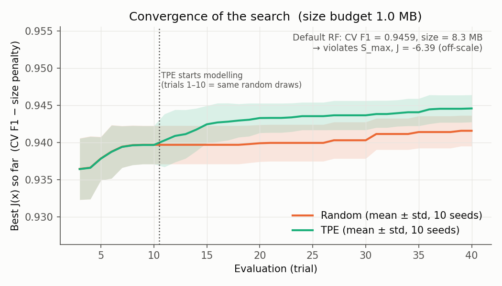
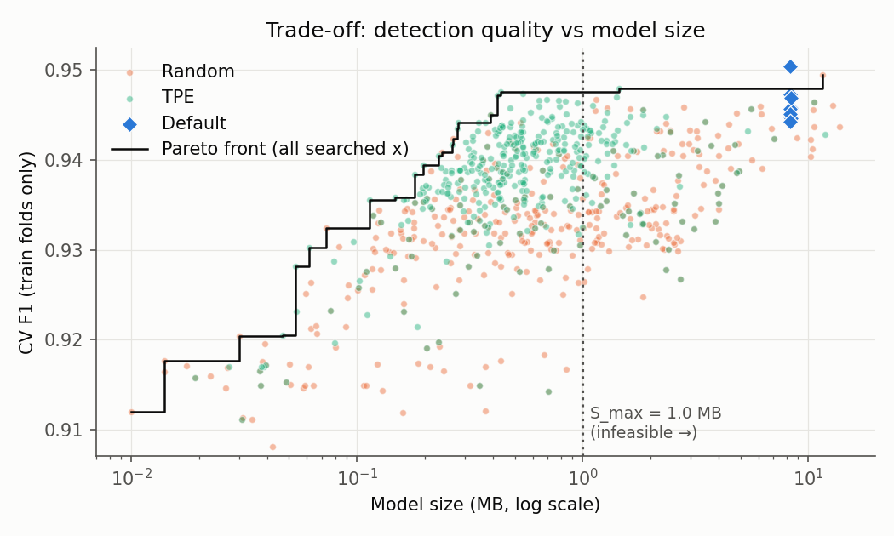
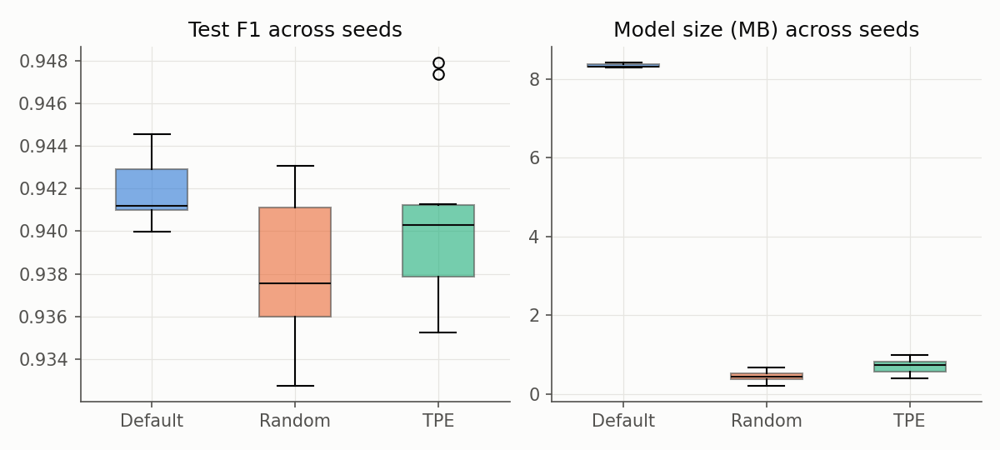

# Detection of a Fake Website — Constrained HPO for Random Forest

Tối ưu siêu tham số Random Forest **có ràng buộc dung lượng mô hình** cho bài toán phát hiện website giả mạo (phishing).
So sánh RF mặc định, Random Search và TPE (Bayesian optimization, Optuna) với cùng dữ liệu, cùng hàm mục tiêu, cùng budget, 10 seed.

> Đồ án môn *Nhập môn Tối ưu hóa* — Trường ĐH Văn Lang.

## Problem

Bộ lọc phishing chạy phía client (extension trình duyệt, thiết bị biên) phải **bắt đúng nhiều site giả** nhưng cũng phải **nhỏ và nhanh**.
RF mặc định của scikit-learn đạt F1 ≈ 0.94 nhưng các cây mọc tới hết độ sâu → mô hình nặng **8.3 MB**.

**Câu hỏi tối ưu:** tìm cấu hình RF có F1 cao nhất mà dung lượng ≤ 1 MB, và xem thuật toán search nào tìm ra nó hiệu quả hơn với cùng số lần đánh giá.

## Optimization Formulation — tối ưu nằm ở đâu?

Huấn luyện RF bên trong (chọn ngưỡng chia theo Gini) là việc của thư viện. **Phần tối ưu của đồ án là tầng ngoài:** chọn x để tối đa J(x).

**Biến quyết định** x ∈ Ω:

| Biến | Miền | Ý nghĩa |
|---|---|---|
| `n_estimators` | int [10, 300], thang log | số cây → chất lượng ↑, dung lượng ↑ |
| `max_depth` | int [2, 30] | độ sâu tối đa → dung lượng tăng theo hàm mũ |
| `min_samples_leaf` | int [1, 20] | số mẫu tối thiểu/lá → cây gọn hơn, ít overfit |
| `max_features` | float [0.05, 1.0] | tỉ lệ đặc trưng xét ở mỗi lần chia |

**Hàm mục tiêu (maximize):**

```
J(x) = F1_cv(x) − λ · max(0, size(x) − S_max) / S_max          λ = 1, S_max = 1.0 MB
```

- `F1_cv(x)`: F1 trung bình 3-fold CV **trên tập train** (lớp dương = phishing).
- `size(x)`: dung lượng pickle (MB) của mô hình fit trên toàn bộ tập train — chính là mô hình sẽ triển khai.

**Ràng buộc:** `g(x) = size(x) − S_max ≤ 0`, xử lý bằng penalty tương đối (vi phạm 50% → trừ 0.5 điểm F1, nên mọi nghiệm vi phạm đều thua nghiệm khả thi).

**Vì sao phải dùng search có budget:** J(x) là hàm hộp đen — không có đạo hàm, mỗi lần tính tốn 4 lần fit RF, có nhiễu, không gian trộn biến nguyên/liên tục. Ràng buộc **active**: RF mặc định vi phạm gấp ~8 lần.

## Dataset

[UCI Phishing Websites (id 327)](https://doi.org/10.24432/C51W2X), Mohammad, Thabtah & McCluskey (2012), CC BY 4.0. 30 đặc trưng đã mã hóa {-1, 0, 1} (URL, tên miền, SSL, HTML/JS...).

- 11 055 dòng → **5 849 dòng sau khi bỏ trùng lặp**. 47% dataset là bản sao; giữ lại sẽ làm cùng một mẫu rơi vào cả train và test.
- Train/test 80/20 phân tầng (`random_state=42`), chung cho mọi phương pháp. **Test chỉ dùng một lần, sau khi search xong.**
- Chi tiết: [`data/README.md`](data/README.md). Dữ liệu được tải tự động khi chạy.

## Method

| Phương pháp | Vai trò | Mô tả |
|---|---|---|
| **Default** | baseline 1 | `RandomForestClassifier()` mặc định, không search |
| **Random Search** | baseline 2 | `optuna.samplers.RandomSampler` — lấy mẫu đều trong Ω |
| **TPE** | phương pháp chính | `optuna.samplers.TPESampler` — 10 trial ngẫu nhiên đầu, sau đó mô hình hóa p(x \| tốt) / p(x \| xấu) để đề xuất x tiếp theo |

Protocol công bằng: cùng split, cùng CV folds (theo seed), cùng J(x), **cùng budget 40 lần đánh giá**, 10 seed (0–9). Với cùng seed, 10 trial đầu của TPE và Random giống hệt nhau, nên khác biệt sau trial 10 là do TPE.

## Key Results

10 seed × 40 trial / phương pháp, mean ± std. Số liệu sinh từ [`results/summary.csv`](results/summary.csv) và [`results/stats.json`](results/stats.json).

| Phương pháp | J (CV) | Test F1 | Test Recall | Size (MB) | Latency (ms/1000 mẫu) | Thời gian search (s) | Khả thi |
|---|---|---|---|---|---|---|---|
| Default | −6.39 ± 0.05 | **0.9418 ± 0.0015** | 0.926 ± 0.003 | 8.34 ± 0.05 | 13.1 ± 0.6 | — | 0/10 |
| Random Search | 0.9416 ± 0.0021 | 0.9381 ± 0.0035 | 0.924 ± 0.008 | 0.45 ± 0.13 | 1.9 ± 0.5 | 37.1 ± 3.2 | 10/10 |
| **TPE** | **0.9444 ± 0.0020** | 0.9402 ± 0.0035 | **0.926 ± 0.007** | 0.73 ± 0.22 | 2.6 ± 0.5 | **19.0 ± 3.1** | 10/10 |







**Đọc kết quả:**

1. **Ràng buộc đáng giá:** TPE giữ F1 test gần như bằng RF mặc định (0.9402 so với 0.9418, chênh 0.0016 ≈ 1 std) và recall bằng nhau, nhưng mô hình **nhỏ hơn ~11 lần** và dự đoán **nhanh hơn ~5 lần**.
2. **TPE tốt hơn Random Search trên mục tiêu tối ưu:** J cao hơn ở 8/10 seed so theo cặp (Wilcoxon p = 0.008). TPE đạt J ≥ 0.94 sau trung bình **10.3** lần đánh giá (10/10 seed); Random cần 17.5 (chỉ 8/10 seed đạt trong 40 lần).
3. **TPE chạy nhanh gấp đôi** với cùng 40 lần đánh giá, vì nó học được vùng mô hình nhỏ (79% trial khả thi so với 62%), mà mô hình nhỏ thì fit nhanh.
4. **Trung thực về test:** khác biệt Test F1 giữa TPE và Random **không có ý nghĩa thống kê** (TPE thắng 6/10 seed, p = 0.16). Lợi thế chắc chắn của TPE là hiệu quả search, không phải độ chính xác trên test.

## Decision

Chọn **TPE** làm phương pháp tối ưu, và cấu hình có J (CV) cao nhất trên 10 seed (chọn theo CV, không nhìn test):

```
n_estimators = 14, max_depth = 12, min_samples_leaf = 1, max_features ≈ 0.87
→ 0.43 MB, 1.7 ms / 1000 mẫu, Test F1 = 0.9400, Precision = 0.960, Recall = 0.921
```

Phù hợp khi cần mô hình ≤ 1 MB chạy phía client. Nếu không có giới hạn dung lượng, RF mặc định vẫn là lựa chọn hợp lý: F1 cao hơn ~0.002, đổi lại nặng hơn 8 MB.
Lưu ý: chọn "tốt nhất trong 10 seed" theo CV cho kết quả lạc quan (CV F1 0.9475 → test 0.9400), nên con số đáng tin hơn là trung bình 10 seed ở bảng trên.

## How to Run

Python 3.10+ (đã chạy trên 3.13, 4 CPU).

```bash
pip install -r requirements.txt
```

Thí nghiệm đầy đủ (~10 phút, ghi vào `results/`):

```bash
python src/experiment.py --seeds 10 --trials 40
```

Vẽ hình + kiểm định thống kê từ CSV (ghi vào `figures/`, `results/stats.json`):

```bash
python src/plots.py
```

Demo nhanh (~1 phút, không ghi đè kết quả chính):

```bash
python src/experiment.py --seeds 2 --trials 12 --out results_demo && python src/plots.py results_demo
```

Kiểm tra:

```bash
python -m pytest -q tests
```

Đổi ngân sách dung lượng / budget: sửa `S_MAX`, `LAMBDA`, `SPACE` ở đầu `src/experiment.py`.

## Repository Structure

```
├─ src/experiment.py     # dữ liệu, J(x), Default / Random / TPE, đánh giá test, logging
├─ src/plots.py          # hình + Wilcoxon từ results/*.csv
├─ tests/                # kiểm tra penalty và Pareto front
├─ results/              # trials.csv (mọi trial), final.csv (mỗi seed), summary.csv, stats.json, config.json
├─ figures/              # convergence, trade-off/Pareto, boxplot
├─ data/README.md        # nguồn, giấy phép, tiền xử lý
└─ docs/de-cuong.md      # phiếu đăng ký đề + kế hoạch 5 tuần
```

## Limitations

- Một dataset; đặc trưng đã được mã hóa sẵn — chưa kiểm tra trên URL phishing mới (concept drift).
- Dung lượng đo bằng kích thước pickle; latency đo trên một máy (single-thread, batch) nên phụ thuộc phần cứng.
- Penalty với λ = 1 là một cách vô hướng hóa; chưa thử ràng buộc cứng (constrained TPE) hay tối ưu đa mục tiêu đầy đủ (NSGA-II).
- Chưa làm sensitivity theo S_max (0.25 / 0.5 / 2 MB) — dự kiến tuần 4.
- 40 trial/lần chạy; với budget lớn hơn khoảng cách TPE–Random có thể thu hẹp.
