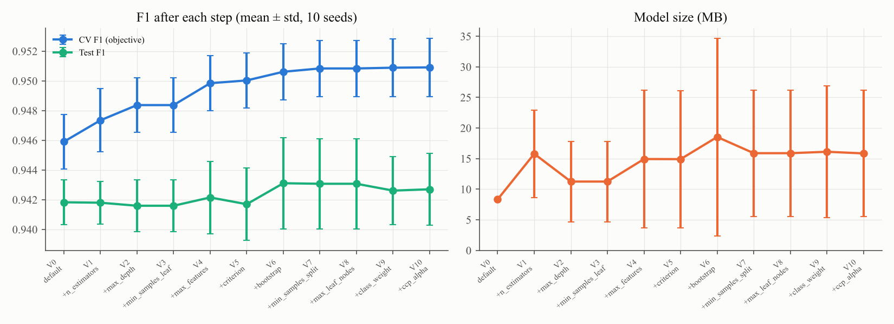
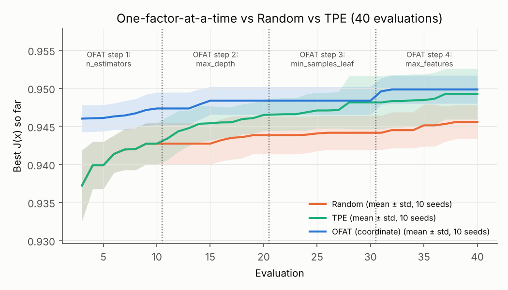

# Detection of a Fake Website — Hyperparameter Optimisation for Random Forest

Tối ưu siêu tham số Random Forest cho bài toán phát hiện website giả mạo (phishing) bằng **tìm kiếm theo từng siêu tham số một** (coordinate search / one-factor-at-a-time), so sánh với RF mặc định, Random Search và TPE (Bayesian optimization, Optuna) trên cùng dữ liệu, cùng hàm mục tiêu, 10 seed.

## Problem

Random Forest là mô hình mạnh cho dữ liệu bảng như đặc trưng URL/tên miền, nhưng chất lượng phụ thuộc vào nhiều siêu tham số mà thư viện để mặc định. **Câu hỏi tối ưu:** thay lần lượt từng siêu tham số so với cấu hình mặc định thì F1 phát hiện website giả tăng được bao nhiêu, mỗi siêu tham số đóng góp gì, và cái giá về dung lượng / thời gian dự đoán là bao nhiêu?

## Optimization Formulation — tối ưu nằm ở đâu?

Huấn luyện RF bên trong (chọn ngưỡng chia theo Gini) là việc của thư viện — đó là **tham số** θ. Phần tối ưu của đồ án là **tầng ngoài**: chọn **siêu tham số** x.

```
x* = argmax  F1_cv(x),   x ∈ Ω
```

- `F1_cv(x)`: F1 trung bình 3-fold kiểm định chéo **trên tập train** (lớp dương = phishing).
- **Biến quyết định** x: 10 siêu tham số, miền Ω là lưới giá trị:

| # | Siêu tham số | Giá trị thử (Ω) | Mặc định |
|---|---|---|---|
| 1 | `n_estimators` | 10, 15, 21, 31, 45, 66, 97, 141, 206, 300 (thang log) | 100 |
| 2 | `max_depth` | 2, 5, 8, 11, 14, 18, 21, 24, 27, 30 | không giới hạn |
| 3 | `min_samples_leaf` | 1, 3, 5, 7, 9, 12, 14, 16, 18, 20 | 1 |
| 4 | `max_features` | 0.05, 0.156, …, 1.0 (10 mức) | sqrt |
| 5 | `criterion` | gini, entropy | gini |
| 6 | `bootstrap` | True, False | True |
| 7 | `min_samples_split` | 2, 4, 8, 16, 32 | 2 |
| 8 | `max_leaf_nodes` | không giới hạn, 16, 32, 64, 128, 256 | không giới hạn |
| 9 | `class_weight` | None, balanced, balanced_subsample | None |
| 10 | `ccp_alpha` | 0, 1e-4, 3e-4, 1e-3, 3e-3, 1e-2 | 0 |

- **Ràng buộc**: x nằm trong lưới Ω; **ngân sách đánh giá** hữu hạn (40 lần cho 4 siêu tham số chính — bằng ngân sách của Random/TPE; +24 lần cho 6 siêu tham số phụ). Mỗi lần đánh giá = 4 lần huấn luyện RF.
- **Trade-off**: không giới hạn dung lượng (đã chấp nhận), nhưng dung lượng mô hình và thời gian dự đoán được đo và báo cáo ở mọi bước.
- F1_cv là **hàm hộp đen**: không có đạo hàm, tốn kém, có nhiễu → giải bằng tìm kiếm có ngân sách.

## Dataset

[UCI Phishing Websites (id 327)](https://doi.org/10.24432/C51W2X), Mohammad, Thabtah & McCluskey (2012), CC BY 4.0. 30 đặc trưng đã mã hóa {-1, 0, 1} (URL, tên miền, SSL, HTML/JS...).

- 11 055 dòng → **5 849 dòng sau khi bỏ trùng lặp** (47% là bản sao; giữ lại sẽ làm rò rỉ dữ liệu train → test).
- Train/test 80/20 phân tầng (`random_state=42`), chung cho mọi phương pháp. **Test chỉ dùng một lần cho mỗi nghiệm cuối, không dùng để chọn cấu hình.**
- Chi tiết: [`data/README.md`](data/README.md). Dữ liệu được tải tự động khi chạy.

## Method

| Phương pháp | Vai trò | Mô tả |
|---|---|---|
| **Default** | baseline | `RandomForestClassifier()` mặc định |
| **Random Search** | baseline | lấy mẫu đều 4 siêu tham số chính, 40 lần đánh giá |
| **TPE** | đối chứng | Bayesian optimization (Optuna), 4 siêu tham số chính, 40 lần đánh giá |
| **Coordinate search (OFAT)** | **phương pháp chính / quyết định cuối** | xuất phát từ mặc định, thay **lần lượt từng siêu tham số một, mỗi tham số một lần**; ở mỗi bước thử mọi giá trị trong lưới, giữ các tham số khác cố định, chọn giá trị có F1_cv cao nhất (giữ nguyên nếu không có giá trị nào tốt hơn). V1–V4: 4 siêu tham số chính (40 lần); V5–V10: 6 siêu tham số phụ (24 lần) |

## Key Results

10 seed, mean ± std. Số liệu sinh từ [`results/method_comparison.json`](results/method_comparison.json), [`results/step_summary.csv`](results/step_summary.csv).

**So sánh phương pháp (cùng hàm mục tiêu, cùng 4 siêu tham số, cùng 40 lần đánh giá; V10 có thêm 6 siêu tham số phụ):**

| Phương pháp | CV F1 | Test F1 | Precision | Recall | Size (MB) | Latency (ms/1000) | Search (s) |
|---|---|---|---|---|---|---|---|
| Default | 0.9459 ± 0.0018 | 0.9418 ± 0.0015 | 0.958 | 0.926 | 8.3 | 11.5 | — |
| Random Search | 0.9456 ± 0.0022 | 0.9410 ± 0.0037 | 0.957 | 0.925 | 6.1 | 12.3 | 28 |
| TPE | 0.9493 ± 0.0033 | 0.9429 ± 0.0031 | 0.962 | 0.925 | 8.3 | 13.7 | 39 |
| OFAT V4 | 0.9498 ± 0.0018 | 0.9422 ± 0.0024 | 0.957 | 0.928 | 14.9 | 19.9 | 53 |
| **OFAT V10** | **0.9509 ± 0.0020** | **0.9427 ± 0.0024** | 0.960 | 0.926 | 15.9 | 20.7 | 86 |

- Cùng 40 lần đánh giá, **OFAT V4 ngang TPE** (CV F1 p = 0.77) và **vượt Random Search** (CV F1 cao hơn ở 10/10 seed, p = 0.002). OFAT vượt CV F1 của RF mặc định sau trung bình **9.5** lần đánh giá (10/10 seed), TPE cần 17.3 (9/10), Random 27.6 (5/10).
- **Trung thực về test:** tối ưu làm CV F1 tăng có ý nghĩa thống kê (V10 so với mặc định: p = 0.002), nhưng **Test F1 chỉ tăng +0.0009, không có ý nghĩa thống kê** (p = 0.51). Trên bộ dữ liệu này RF mặc định đã gần tối ưu; phần lớn cải thiện CV là lạc quan do chọn trên ước lượng có nhiễu.

**Mỗi siêu tham số đã tối ưu được gì (V0 → V10, thay đổi so với bước trước, trung bình theo seed):**

| Bước | Siêu tham số thay | Giá trị được chọn (số seed) | Số seed đổi | ΔCV F1 | ΔTest F1 | Size (MB) |
|---|---|---|---|---|---|---|
| V0 | — (mặc định) | 100 cây, không giới hạn độ sâu | — | 0.9459 | 0.9418 | 8.3 |
| V1 | `n_estimators` | 141 (3), 300 (3), 206 (2), 100, 66 | 9/10 | +0.0014 | 0.0000 | 15.8 |
| V2 | `max_depth` | 14 (4), 11 (3), không giới hạn (2), 21 | 8/10 | +0.0010 | −0.0002 | 11.2 |
| V3 | `min_samples_leaf` | 1 (10) | 0/10 | 0 | 0 | 11.2 |
| V4 | `max_features` | 0.05 (5), sqrt (3), 0.156 (2) | 7/10 | +0.0015 | +0.0006 | 14.9 |
| V5 | `criterion` | gini (8), entropy (2) | 2/10 | +0.0002 | −0.0005 | 14.9 |
| V6 | `bootstrap` | False (6), True (4) | 6/10 | +0.0006 | +0.0014 | 18.5 |
| V7 | `min_samples_split` | 2 (8), 4, 8 | 2/10 | +0.0002 | 0.0000 | 15.9 |
| V8 | `max_leaf_nodes` | không giới hạn (10) | 0/10 | 0 | 0 | 15.9 |
| V9 | `class_weight` | None (9), balanced (1) | 1/10 | +0.0000 | −0.0005 | 16.1 |
| V10 | `ccp_alpha` | 0 (9), 1e-4 (1) | 1/10 | +0.0000 | +0.0001 | 15.9 |

- **Có tác dụng rõ:** `n_estimators` (nhiều cây → giảm phương sai), `max_depth` (giới hạn độ sâu → mô hình nhỏ lại ~29% mà CV F1 vẫn tăng), `max_features` (xét ít đặc trưng mỗi lần chia → các cây đa dạng hơn), `bootstrap = False` (mỗi cây thấy toàn bộ dữ liệu; mức tăng Test F1 lớn nhất, +0.0014).
- **Không cần tối ưu:** `min_samples_leaf`, `max_leaf_nodes` (mặc định đã tốt nhất ở mọi seed); `criterion`, `class_weight`, `ccp_alpha` gần như không đổi (dữ liệu cân bằng 51.6%, không có ràng buộc dung lượng nên không cần cắt tỉa).





## Decision

Quyết định cuối: **coordinate search V10**, cấu hình của lần chạy có CV F1 cao nhất trong 10 seed (chọn theo CV, không nhìn test) — [`results/decision.json`](results/decision.json):

```
n_estimators = 300, max_depth = 14, min_samples_leaf = 1, max_features = 0.05,
criterion = gini, bootstrap = False, min_samples_split = 2, max_leaf_nodes = None,
class_weight = balanced, ccp_alpha = 0
→ CV F1 0.9533 | Test F1 0.9444, Precision 0.962, Recall 0.927 | 34.2 MB, 37 ms / 1000 mẫu
```

- Chấp nhận mô hình lớn (34 MB, gấp ~4 lần mặc định) và chậm hơn (~3 lần) để lấy F1 cao nhất trên CV.
- Con số đáng tin để kỳ vọng trên dữ liệu mới là **trung bình 10 seed: Test F1 0.9427 ± 0.0024**; Test F1 0.9444 của cấu hình được chọn có phần may mắn (chọn cấu hình tốt nhất trong 10 lần chạy theo CV).

## Overfitting check

`src/overfitting_check.py` (số liệu trong `results/overfitting_*`):

- Train F1 cao hơn CV F1 ~0.026 (bình thường với RF); **CV − Test của OFAT V10 = 0.0082**, lớn hơn Default (0.0041) và TPE (0.0064) → càng tối ưu nhiều siêu tham số trên CV, ước lượng CV càng lạc quan.
- Lặp lại toàn bộ quy trình V0 → V10 trên 5 cách chia train/test mới: CV − Test = 0.0004 ± 0.0090 (mặc định: −0.0031 ± 0.0063). Trên cả cách chia chính lẫn cách chia mới, khoảng cách của V10 lớn hơn mặc định ~0.004 → **mức lạc quan của CV do tối ưu ≈ 0.004**. Test F1 trên các cách chia mới: 0.9498 so với 0.9477 của mặc định (V10 tốt hơn ở 3/5 cách chia).
- Learning curve: mô hình được chọn học thuộc ít hơn mặc định (train F1 0.978 so với 0.994) và đường validation vẫn đang đi lên → thêm dữ liệu sẽ còn cải thiện.
- Không có rò rỉ: 24 dòng test (2.1%) trùng vector đặc trưng với train nhưng **đều mang nhãn ngược** (nhiễu nhãn của dataset).

## How to Run

Python 3.10+ (đã chạy trên 3.13, 4 CPU).

```bash
pip install -r requirements.txt
```

So sánh Default / Random / TPE (~15 phút, ghi `results/`), rồi vẽ hình + kiểm định:

```bash
python src/experiment.py --seeds 10 --trials 40
```

```bash
python src/plots.py
```

Tối ưu từng siêu tham số V0–V4 rồi V5–V10 (~15 phút), tổng hợp từng bước và quyết định cuối:

```bash
python src/ofat_search.py
```

```bash
python src/ofat_extra.py
```

```bash
python src/step_summary.py
```

Kiểm tra overfitting (~10 phút) và test:

```bash
python src/overfitting_check.py
```

```bash
python -m pytest -q tests
```

Thử nhanh một cấu hình thủ công so với quyết định cuối (ghi `results_trial/`, không ảnh hưởng kết quả chính):

```bash
python src/try_config.py --n-estimators 50 --max-depth 15
```

## Repository Structure

```
├─ src/experiment.py      # dữ liệu, hàm mục tiêu, Default / Random / TPE, đánh giá test
├─ src/ofat_search.py     # tối ưu từng siêu tham số: V0–V4 (4 siêu tham số chính)
├─ src/ofat_extra.py      # tiếp tục V5–V10 (6 siêu tham số phụ)
├─ src/step_summary.py    # mỗi bước tối ưu được gì, quyết định cuối, so sánh phương pháp
├─ src/plots.py           # hình hội tụ, trade-off, boxplot, Wilcoxon
├─ src/overfitting_check.py  # train/CV/test, cách chia mới, learning curve, rò rỉ dữ liệu
├─ src/try_config.py      # thử cấu hình thủ công (sandbox)
├─ tests/                 # kiểm tra hàm mục tiêu, Pareto, coordinate search, chuẩn hóa tham số
├─ results/               # trials.csv, final.csv, summary.csv, stats.json, config.json,
│                         # ofat/, ofat_extra/, step_summary.csv, decision.json, method_comparison.json, overfitting_*
├─ figures/               # ofat_steps, ofat_convergence, ofat_versions, ofat_extra_versions, convergence, tradeoff, boxplot, learning_curve
├─ results_trial/         # lưu trữ phiên bản cũ có ngân sách 1 MB (không dùng cho quyết định cuối)
├─ data/README.md         # nguồn, giấy phép, tiền xử lý
└─ docs/de-cuong.md       # phiếu đăng ký đề + kế hoạch 5 tuần
```
